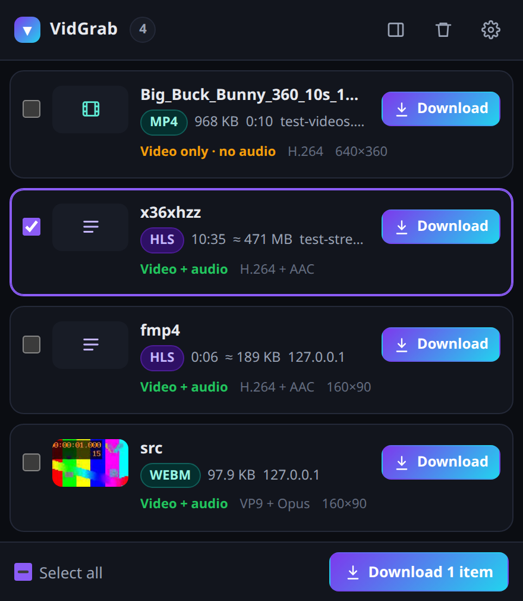
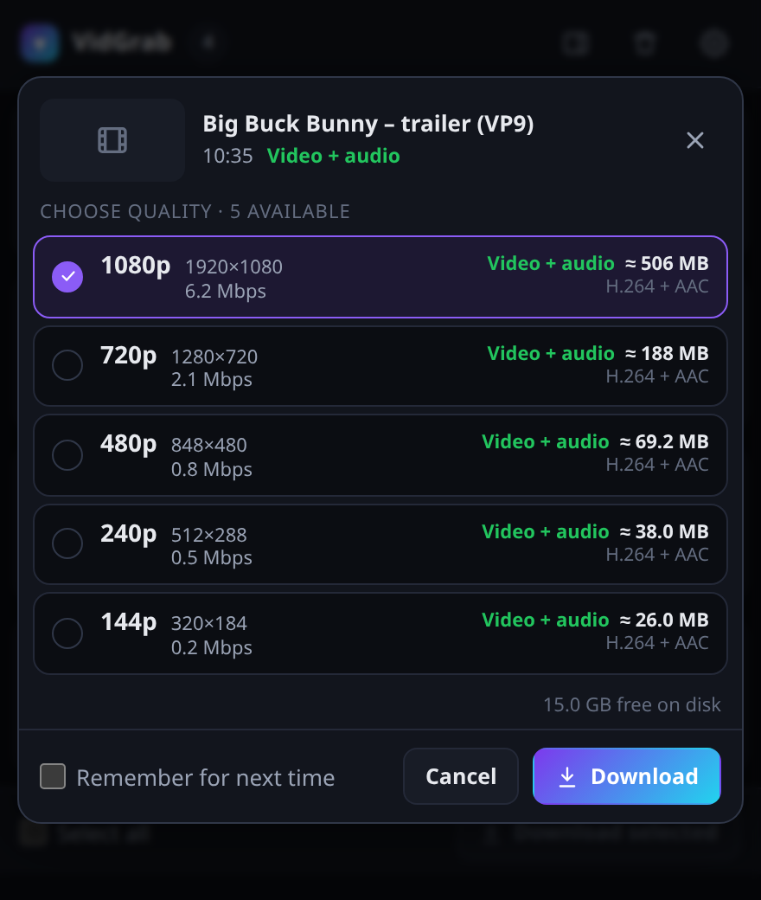
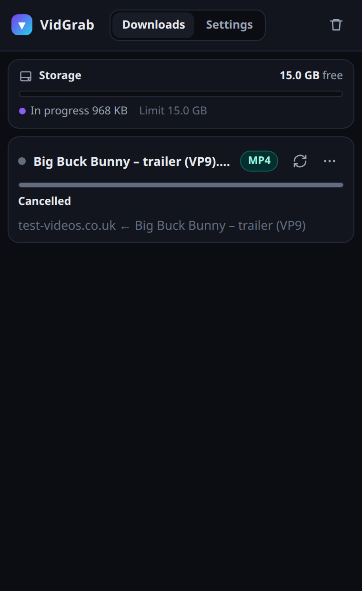
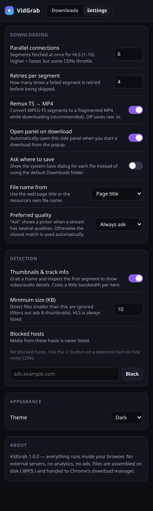

# VidGrab

A private video downloader for Chrome. It finds the videos a page is playing (HLS / m3u8, MP4, WebM, audio), lets you pick a quality, and saves a normal MP4 to your Downloads folder.

Everything runs inside the extension. No servers, no accounts, no ads, no tracking.

<p align="center">
  
  
</p>

## Features

- **Detects media automatically** – HLS (m3u8), MP4, WebM, MKV, MP3/M4A and more. The toolbar badge shows how many were found.
- **Quality picker** – resolution, bitrate, codecs and estimated file size for every quality. Optionally remember your preferred quality.
- **Track info & thumbnails** – shows whether a stream is *video + audio*, *video only* or *audio only*, plus a preview frame.
- **One file, with sound** – HLS segments (TS or fMP4) and separate audio tracks are merged into a single MP4 that plays in any player.
- **AES-128** encrypted streams are supported.
- **Download manager in the side panel** – progress, speed, ETA, pause / resume, restart, copy link, and disk-space info.
- **Reliable on slow servers** – parallel downloads, automatic retries, stall detection, and fresh links when a CDN link expires.
- **Large files are fine** – data is written to disk while downloading, not kept in memory.

## Install

VidGrab is not on the Chrome Web Store yet. Install it from source:

```bash
git clone https://github.com/mrbeandev/vidgrab.git
cd vidgrab
npm install
npm run build
```

Then in Chrome:

1. Open `chrome://extensions`
2. Turn on **Developer mode** (top right)
3. Click **Load unpacked** and select the `dist` folder

## Usage

1. Open a page with a video and **start playing it** (most players only request the stream once playback starts).
2. Click the VidGrab icon. Detected videos are listed with size, duration and track info.
3. Click **Download** and pick a quality.
4. Progress shows in the side panel. When it's done, the file is in your Downloads folder.

<p align="center">
  
  
</p>

## What it can't download

- **DRM-protected video** (Netflix, Prime Video, Disney+, Spotify, …) – this is encrypted on purpose and is not supported.
- **YouTube** – uses a proprietary format; use [yt-dlp](https://github.com/yt-dlp/yt-dlp) instead.
- **Live streams** – detected, but not downloadable yet.
- **DASH (`.mpd`)** streams – not supported yet.

Please only download content you have the right to save.

## Permissions

| Permission | Why |
|---|---|
| `webRequest`, host access | See which media files a page loads |
| `declarativeNetRequest` | Send the page's Referer/Origin with the download so servers accept it |
| `offscreen` | Run the downloader in the background |
| `downloads` | Save the finished file |
| `sidePanel`, `storage`, `tabs`, `alarms`, `unlimitedStorage` | Side panel UI, settings, per-tab lists, temp files on disk |

## Development

```bash
npm run dev        # rebuild on change (reload the extension in chrome://extensions)
npm run build      # type-check + production build into dist/
npm test           # unit tests (playlist parser, track detection, MP4 writer)
```

End-to-end tests load the extension in a real Chromium and download test streams.
Branded Google Chrome can't load extensions from the command line, so use a Chromium build:

```bash
npx @puppeteer/browsers install chromium@latest
CHROME_BIN=/path/to/chromium npm run smoke
```

`ffmpeg` / `ffprobe` (and optionally `cvlc`) are used by the tests to check the output files.

### Project layout

```
src/background/   service worker: media detection, header rules, download jobs
src/offscreen/    download engine: segments, AES-128, TS → MP4, MP4 writer
src/popup/        toolbar popup: detected media, quality picker, thumbnails
src/sidepanel/    download manager and settings
src/shared/       playlist parser, container probes, types, UI helpers
tests/            unit tests and small test streams
scripts/          icon generator, end-to-end and screenshot scripts
```

Built with TypeScript and Vite, plus [hls.js](https://github.com/video-dev/hls.js) for previews and [mux.js](https://github.com/videojs/mux.js) for TS → MP4 conversion.

## License

[MIT](LICENSE)
